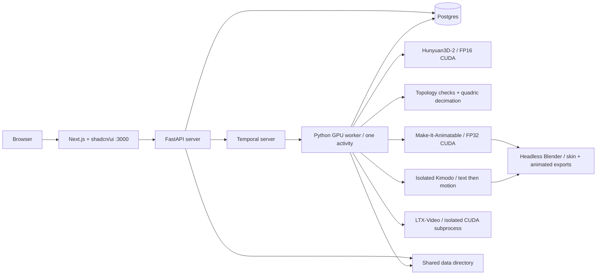

# Low Poly Studio

A local image-to-3D, character animation, and video workspace. Next.js + shadcn/ui on the front, FastAPI and Temporal behind it, with Postgres storing the library and job state. No accounts, app API keys, or Hugging Face login.

Upload one image or a batch of up to 16. Generate with Hunyuan3D-2, reduce the mesh while checking connectivity and surface topology, inspect it in 3D, and download GLB or OBJ. Imported GLB/OBJ meshes use the same reduction pipeline. Originals stay on disk so new vertex budgets do not repeat AI generation. Make-It-Animatable adds a humanoid skeleton; Kimodo generates motion from a prompt and exports animated GLB/FBX characters.

## Start

Requires Linux, Python 3.10 or newer for setup, Docker Compose, the NVIDIA Container Toolkit, a compatible NVIDIA driver, and enough disk for the model and images. The GPU worker uses PyTorch 2.7.1 / CUDA 12.8 and keeps the active model on CUDA: Hunyuan in FP16, MIA in FP32, or Kimodo with its NF4 text encoder. Each stage releases its model before loading the next; model weights are never offloaded to CPU for inference. Background removal, mesh processing, and headless Blender exports run on CPU.

From the repository root:

```bash
python3 scripts/setup-env.py
docker compose up -d --build
```

The setup script creates an ignored `.env` with a unique database password and permissions restricted to your user. It preserves an existing configuration. Docker Compose requires a nonempty `POSTGRES_PASSWORD`; there is no shared default password. For an existing Postgres volume, set `.env` to its current password before starting: changing the environment variable does not change the password stored in the database. Do not commit `.env` or share the output of `docker compose config`, which contains resolved credentials.

Open `http://localhost:3000`; Temporal's job inspector is at `http://localhost:8080`. Both bind to loopback by default. For LAN access, set `STUDIO_BIND_ADDRESS` in `.env` to the intended interface address and connect using that address. Postgres, the API, and Temporal's gRPC port stay inside the Compose network. There is no authentication: clients that can reach the web port can upload, run jobs, and download the library. Keep access limited to a trusted local network.

The first use of each model downloads its checkpoints; background removal downloads its weights when needed. Downloads keep workflow heartbeats active. `HUNYUAN_CACHE_VOLUME` selects the persistent model cache, defaulting to `low-poly-studio-model-cache`. Stop other GPU generation workloads before starting the worker.

```bash
docker compose ps                       # worker becomes healthy when ready to accept jobs
docker compose logs -f worker           # model load and activity errors
docker compose logs -f server           # HTTP API and workflow dispatch
docker compose stop                     # stop without deleting data
docker compose up -d                    # resume
```

## Workflow

1. Add PNG/JPEG/WebP images, or existing GLB/OBJ meshes. Maximum 50 MB per file; images up to 25 megapixels.
2. Choose a vertex budget and faceted/smooth shading. Default: about 1,000 geometric vertices, 30 steps, resolution 256, seed 42. A budget of zero keeps original density.
3. Generate. A batch creates independent jobs; one GPU activity runs at a time. You can cancel queued/running jobs or retry failures.
4. Open the collection to select a saved asset. The framed Three.js preview supports orbit, zoom, wireframe, skeleton display, and browser fullscreen. A fixed 100 × 100 ground grid uses one preview unit per cell, with stronger lines every ten units and theme-aware colors. The settings panel can be collapsed. The searchable library opens in a drawer with filters for 3D assets and videos.
5. **Create** saves mesh versions from the original reconstruction. Enable **Rig as a character** to include rigging in the asset workflow.
6. **Animate** takes a saved character, reuses or creates its rig, generates motion, corrects foot contacts, and exports the animated character. Enter a prompt, choose 2–10 seconds, 50/100 steps, and in-place/travelling root motion. Default: five seconds, 50 steps, seed 42. Each clip is a separate saved version.
7. Play, pause, scrub, change playback speed, or compare the bind pose. The camera follows horizontal root travel; the stage renders on demand when idle. Thumbnail cards beneath the preview switch recent animations, meshes, and videos; animation cards show their motion prompts.
8. **Download files** provides the mesh, bind rig, animated GLB/FBX, and generated BVH. The BVH is the original SOMA motion, while animated GLB/FBX is retargeted to the character's 22-bone rig.

The workspace supports light and dark themes, a dedicated settings panel, and a preview that stays clear of controls. On mobile, settings stack below the preview. **New asset** / **New video** starts a fresh draft, **Queue** shows pending work and cancellation, and advanced settings remain collapsed until requested. Download the current result directly from the preview toolbar. The library supports Escape and returns keyboard focus when closed. The collection shows the most recent 200 jobs grouped by source. Imports support drag-and-drop and batches of up to 16 files.

The budget is approximate. When a reduction would break the checked topology, the original is retained and the interface explains why. Thin details still depend on the generated original. Reduction is triangle decimation, not quad retopology. Rigging is a separate operation on the exact saved mesh. Faceted GLB splits rendering vertices for hard normals; OBJ retains shared geometric vertices. The interface reports geometric vertex count.

Testing used an NVIDIA RTX 5060 with 8 GB VRAM. Peak CUDA usage is recorded per job; fitting a separate 6 GB card is not guaranteed. Lowering the output vertex count affects the reduction stage, not Hunyuan's generation memory. The API supports decode batch sizes of 1,000–8,000 when memory needs reducing.

## Video

Open **Video**, describe the scene, and click **Generate video**. Optionally add a PNG/JPEG/WebP starting image; it is center-cropped to the output aspect ratio. Clips appear in the collection with native video playback and an MP4 download. **New video** clears the prompt and starting image. Prompt ideas provide a starting point; switching workspaces preserves an unfinished video prompt. Ctrl/Cmd+Enter submits the generation form. Dragging a file over the studio shows the supported input types.

The preset is **LTX-Video 2B 0.9.8 distilled FP8 + T5 XXL Q3_K_S**, **320 × 192**, **81 frames at 16 FPS** (5.0625 seconds), **8 Euler steps**, CFG 1. The seed is editable; resolution, length, and step count are fixed to the tested memory budget. Motion instructions are not always followed precisely.

The transformer, text encoder, and VAE stay on CUDA throughout inference. The worker releases its previous active model before launching the video subprocess. GPU-only embedding lookup dequantizes the vocabulary rows actually used by the prompt; tiled VAE decoding also runs on GPU. Memory pressure fails generation instead of enabling CPU offloading. CPU image preparation and MP4 encoding are ordinary file processing. Video jobs use the same single-activity queue, cancellation, retries, and library as mesh and animation jobs.

The isolated `/opt/ltx` environment and pinned ComfyUI/GGUF sources are built into the worker image. Checkpoints download on first use into the existing model-cache volume under `huggingface/ltx-video`; initial downloads are checksum-verified. Saved MP4, thumbnail, settings, GPU device checks, memory metrics, and process log live in `data/exports/<job-id>/video/`.

The API accepts `POST /api/videos` with `{"settings":{"prompt":"A red toy car drives across a table.","seed":42}}`; include an uploaded image's `asset_id` for image-to-video. Responses use the existing `jobs` envelope. Video files support HTTP range requests for seeking. Video jobs cannot be used as meshes, rigs, or character animations.

Run `python3 scripts/video-check.py` against the running app to generate and verify both text-to-video and image-to-video. It checks CUDA residency, duration, downloads, range requests, thumbnails, and API boundaries. Set `STUDIO_URL` for another address. `scripts/video-browser.cjs` checks the actual Video workspace with Playwright. `scripts/ui-review.cjs` checks workspace switching, prompt ideas, image input, seed controls, library filtering and keyboard focus, direct downloads, 320/390 px mobile layouts, and animation playback; screenshots and its report are saved in `artifacts/ui-*`.

Video inference uses [ComfyUI](https://github.com/Comfy-Org/ComfyUI) at `eee59185ff4f43ae2d9ad122b245619d27d9daad` and [ComfyUI-GGUF](https://github.com/city96/ComfyUI-GGUF) at `6ea2651e7df66d7585f6ffee804b20e92fb38b8a`. Weights come from [Lightricks/LTX-Video](https://huggingface.co/Lightricks/LTX-Video) and [city96's T5 quantizations](https://huggingface.co/city96/t5-v1_1-xxl-encoder-gguf). Exact revisions and SHA-256 hashes are pinned in `server/studio/pipeline/video.py`; upstream licenses remain applicable.

## Rigging scope

MIA predicts joints and skin weights for humanoids. This version folds finger weights into the hands, limits each vertex to four normalized influences, and preserves the original bind geometry and faceted shading. The 22-bone hierarchy uses Mixamo names. Rigging never replaces the saved static mesh.

Kimodo uses a public NF4 LLM2Vec encoder and the pinned SOMA-RP v1.2 motion model. No token is needed. The original NVIDIA encoder does not fit the tested 8 GB GPU; this integration uses the benchmarked quantized encoder. Encoding and motion sampling run in separate processes with all model weights on CUDA. The quantized encoder has not been compared against a BF16 quality reference.

Retargeting transfers global rotation deltas onto the saved bind skeleton, scales root motion to leg length, and bakes a two-bone leg IK correction using Kimodo's foot contacts. In-place clips retain vertical motion and remove horizontal root travel after correction. Source motion and rig files remain unchanged. Playback repeats the clip; generated endpoints are not guaranteed to form a seamless loop. Foot drift and contact reach error are recorded; large reach errors appear in the inspector. This is not a universal retargeter or weight editor: very short limbs and poor skin weights can still deform badly. There are no facial, finger, or tail controls. Inspect exported motion before using it as finished animation. Other Mixamo/Rokoko clips require their own retargeting adapter.

## Architecture



- **server/**: upload validation, job API, durable workflow dispatch, model adapter, geometry pipeline, worker, and tests.
- **web/**: Next.js App Router with three substantive UI modules: `studio.tsx` owns the workspace state and operations, `viewport.tsx` owns 3D rendering, and `controls.tsx` contains the shared shadcn primitives. Theme setup lives directly in the app layout.
- **infra/**: Postgres databases, idempotent Temporal schema/namespace initialization, dynamic configuration.
- **compose.yaml**: web, API, worker, Postgres, Temporal server/UI, and one-time initialization services.
- **examples/**: character and chair reference images, with upstream attribution below.

Postgres stores assets, settings, parent/variant relationships, operation, status, progress, metrics, reconstruction cache keys, and an artifact map. A committed job row is a durable dispatch outbox. Stable Temporal workflow IDs prevent duplicate dispatch after API restarts. Activities heartbeat during generation, retry transient failures up to three times, and observe cancellation between stages/denoising steps. Surface extraction and a mesh-reduction call finish before cancellation is observed. `AssetWorkflow` runs `prepare_mesh` → optional `rig_character` → `finish_job`. `AnimationWorkflow` runs `rig_character` → `generate_motion` → `export_animation` → `finish_job`. Completed stages save their artifacts before the next activity begins. Animation requests snapshot the exact source mesh and rig paths; retries never reconstruct or simplify that mesh. Rig predictions, text embeddings, and generated motion survive activity/worker failures.

The motion runtime lives at `/opt/kimodo`, isolated from Hunyuan/MIA dependencies. The existing worker supervises its child processes and Blender. Cancellation terminates the child process group, waits for it to exit, and only then releases the activity slot. Native in-process GPU work drains before cancellation completes. No second worker or independent service competes for the GPU.

One worker owns model construction and release on its main thread. GPU inference runs in a background thread with cancellation draining; activity concurrency stays at one. Separate activities can interleave across jobs, so mixed batches can incur model reloads. Do not scale GPU workers on the same device without a separate scheduler.

The cache key includes normalized image pixels, model revision, seed, steps, resolution, background removal, and decode batch size; it excludes the output vertex budget and shading. Cached original geometry and database metadata survive restarts. No model credentials are sent to the browser.

## Data and backup

`data/` is bind-mounted into the API and worker:

- `uploads/`: input files and thumbnails.
- `originals/<cache-key>/`: full reconstruction and prepared image.
- `exports/<job-id>/`: GLB, OBJ, shared geometry, a rendered thumbnail, and metrics JSON.
- `rigs/<cache-key>/`: MIA prediction checkpoint, bind GLB/FBX, and metrics. Keys include exact geometry content, shading, and model/source revisions.
- `embeddings/<cache-key>`: reusable text vectors keyed by prompt and encoder revision.
- `motions/<cache-key>/`: generated BVH, NPZ, foot contacts, and metrics. Keys include prompt, seed, duration, steps, and model revisions; root-motion export mode is excluded.
- `exports/<job-id>/animation/`: settings, animated GLB/FBX, retarget metrics, and process log. Jobs reference immutable source artifacts rather than modifying them.

Postgres lives in the `low-poly-studio_postgres-data` named volume. Model weights live in the configured cache volume. Keep both the database and `data/` for a complete library backup. Do not use `docker compose down -v` when you want to preserve these volumes, particularly the shared model cache.

For a consistent backup, stop writes first:

```bash
mkdir -p backups
docker compose stop web server worker
docker compose exec -T postgres pg_dump -U studio -d studio > backups/studio.sql
tar -czf backups/assets.tar.gz data
docker compose up -d
```

Temporal state is in the same Postgres cluster under separate `temporal` and `temporal_visibility` databases. Back those up too if you need to preserve workflow history/in-flight work. The schema initialization scripts are safe to rerun. The API applies tracked SQL migrations in `server/studio/migrations/` under a database lock. The artifact migration preserves existing exports and removes obsolete per-format columns.

## Validation

The host integration scripts default to `http://localhost:3000`. Set `STUDIO_URL` when using a different port or a LAN deployment. Recovery checks require an idle studio and the sample jobs produced by `scripts/smoke.py`. Browser checks require completed mesh, animation, and video entries; they are not a fresh-install smoke test.

```bash
# Shared geometry, export, attention cache, import, and budget tests; no GPU required:
docker compose run --rm --no-deps worker python -m pytest tests -q

# Actual API + Temporal + GPU integration; creates sample jobs:
docker compose exec -T server python -u - < scripts/smoke.py
```

See [VERIFICATION.md](VERIFICATION.md) for measured results. `scripts/recovery.py` exercises worker crashes and API restarts; run it only when no user jobs are active. `scripts/import-check.py` checks mesh import and opaque image preprocessing inside the server container.

`scripts/browser.cjs` uses Playwright 1.65.0 to check real clip/variant creation, full-screen rendering, playback/pause/scrub/speed, bind comparison, skeleton, downloads, library search, light/dark themes, and mobile. Set `STUDIO_URL` and `ARTIFACT_DIR` as needed. For a reproducible browser run:

```bash
docker run --rm --network host -v "$PWD:/project" -v studio-browser-tools:/tests -w /tests \
  mcr.microsoft.com/playwright:v1.65.0-noble sh -c \
  'npm install --no-audit --no-fund playwright@1.65.0 && NODE_PATH=/tests/node_modules ARTIFACT_DIR=/project/artifacts node /project/scripts/browser.cjs'
```

Animation integration checks create real jobs and deliberately stop the worker. Run them only while the studio is idle:

```bash
# Uses the sample character from scripts/smoke.py.
# Set STUDIO_SOURCE_JOB_ID to use another completed humanoid mesh.
python3 scripts/animation.py

docker compose run --rm --no-deps -v "$PWD/scripts:/scripts:ro" worker \
  /opt/blender/blender --background --python-use-system-env --python-exit-code 1 \
  --python /scripts/rigging.py -- /data/exports/ANIMATION_JOB_ID/animation --rig /data/rigs/RIG_KEY/rig.glb
```

The integration script checks asset → rig → motion, cancellation and process cleanup, retry after a deliberately killed export, motion checkpoint reuse, worker restart during motion generation, Hunyuan reload, and unchanged source geometry. The Blender validator independently imports bind and animated GLB/FBX, checks skeleton/skin weights, compares export poses, verifies durations, and writes a pose sheet.

## Kimodo benchmark

The production worker also supplies the benchmark runtime. Historical measurements are in [VERIFICATION.md](VERIFICATION.md#kimodo-benchmark--2026-11-13). To repeat the model-only sweep, wait for active jobs to finish and run:

```bash
(
  set -e
  trap 'docker compose start worker' EXIT
  docker compose stop worker
  for stage in download encode motion; do
    docker compose run --rm --no-deps -v "$PWD:/benchmark" worker \
      /opt/kimodo/bin/python -I /benchmark/scripts/motion-benchmark.py "$stage"
  done
)
```

The benchmark uses the same pinned model identities as production. The earlier standalone benchmark image and retarget implementation have been replaced by the worker runtime and production animation workflow.

## Model and source credits

- [Tencent Hunyuan3D-2](https://github.com/Tencent-Hunyuan/Hunyuan3D-2), source commit `f8db63096c8282cb27354314d896feba5ba6ff8a`. Model `tencent/Hunyuan3D-2/hunyuan3d-dit-v2-0`, revision `9cd649ba6913f7a852e3286bad86bfa9a2d83dcf`. Its upstream model/code license applies separately.
- [Make-It-Animatable](https://github.com/jasongzy/Make-It-Animatable), source `8fb51382ff6da556cdb95cc03a48200603f3a493`, model revision `ca0daf6cb164f939e77bf32667513fc7558d5f98`. The MIT license is in `notices/`. Four inference checkpoints are used: coarse joints, joints, weights, and normal-informed weights.
- Animation uses [NVIDIA Kimodo](https://github.com/nv-tlabs/kimodo), [Kimodo-SOMA-RP-v1.2](https://huggingface.co/nvidia/Kimodo-SOMA-RP-v1.2), and [matbee's NF4 LLM2Vec encoder](https://huggingface.co/matbee/kimodo-llm2vec-nf4). Source is Apache-2.0, motion weights use the NVIDIA Open Model License, and the encoder retains the Meta Llama 3 license. Revisions are pinned in `server/studio/pipeline/motion.py` and the worker image.
- The Mixamo reference skeleton comes from the public [Three.js Xbot example](https://github.com/mrdoob/three.js/blob/b6f7fd42487ba75d6e9c11c09c6059daa83a67d7/examples/models/gltf/Xbot.glb). The Docker build verifies SHA-256 `002f8d269de68e5dce3d25195caf390d1aa359bbfaae3fcf4c8dc78ec36c3ba5` before extracting the skeleton. It does not use the gated MIA training dataset or require Mixamo credentials. Xbot geometry is not included in character exports.
- [Blender](https://www.blender.org/) 4.2.21 LTS performs exports as a separate headless process. The image pins its archive checksum. The GPU process does not import `bpy`. A small pinned-source patch defers Blender-only dataset imports and reads the skeleton hierarchy generated during the image build. This avoids an Embree library collision with mesh reduction. PyTorch3D is pinned to `75ebeeaea0908c5527e7b1e305fbc7681382db47` with native extensions disabled; this pipeline uses its Torch transforms.
- [trimesh](https://github.com/mikedh/trimesh) for mesh IO and inspection; [PyMeshLab](https://github.com/cnr-isti-vclab/PyMeshLab) for decimation.
- [shadcn/ui](https://ui.shadcn.com) primitives from the Base Nova preset, consolidated into one controls module; themes use CSS variables and next-themes.
- `examples/character.png` and `examples/chair.png` came from [Stable Fast 3D demo files](https://github.com/Stability-AI/stable-fast-3d/tree/main/demo_files/examples). The upstream Stability AI Community License is included in `notices/`; attribution is in [NOTICE](NOTICE). Powered by Stability AI (example images only).

Job creation, variant creation, rigging, retry, and cancellation share a `jobs` array in their response. The workspace updates from that result, then resumes serial polling; failures keep the selected shape and report the error. Mesh thumbnail generation lives with geometry exports, uses CPU rasterization, and does not require a second GPU renderer.

## License

Original project code is available under the [MIT License](LICENSE). Third-party dependencies, model weights, and bundled example images retain their own licenses; see [NOTICE](NOTICE), `notices/`, and the credits above. Model checkpoints are downloaded separately and are not included in this repository.
