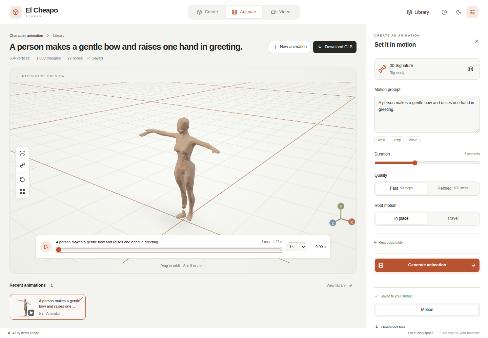
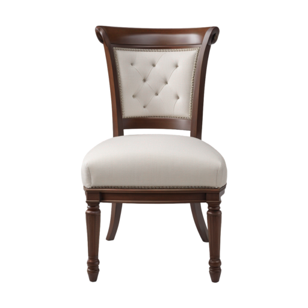
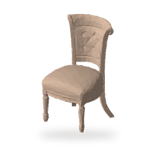
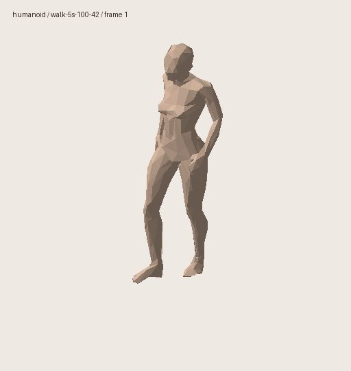
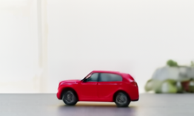

# El Cheapo Studio

Turn images into low-poly models, animate characters, and generate short videos locally.



| Input image | Generated mesh | Walking animation | Generated video |
| :---: | :---: | :---: | :---: |
|  |  |  | [](docs/images/video.mp4) |
| Upload an image | Export GLB / OBJ | Export GLB / FBX | [Sample MP4](docs/images/video.mp4) |

## Run

Requires Linux, Python 3.10+, Docker Compose, and an NVIDIA GPU with the NVIDIA Container Toolkit. Tested on an RTX 5060 with 8 GB VRAM.

```bash
git clone https://github.com/dioveath/el-cheapo-studio.git
cd el-cheapo-studio
python3 scripts/setup-env.py
docker compose up -d --build
```

Open **http://localhost:3000**. Models download on first use. No API keys required.

The app has no authentication; keep it on localhost or a trusted network.

[Setup & technical guide](docs/guide.md) · [Test results](VERIFICATION.md) · [MIT license](LICENSE) · [Third-party notices](NOTICE)

Models and example assets retain their own licenses. Powered by Stability AI (example images).
