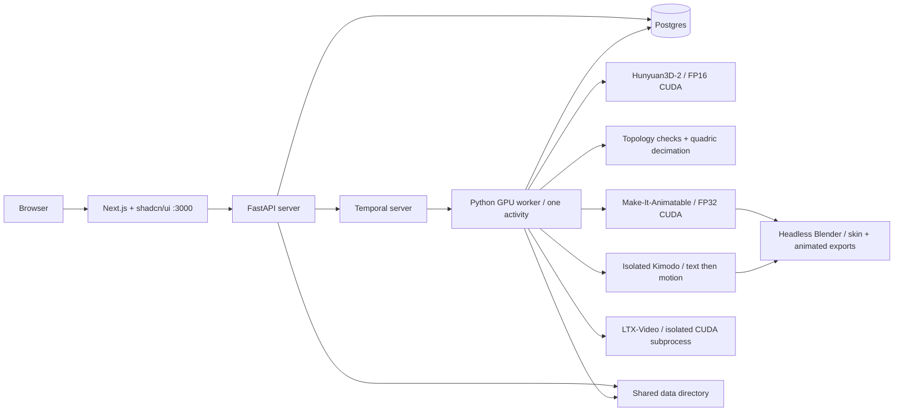

# Low Poly Studio guide

A local workspace for generating 3D assets, character animation, and video. Built with Next.js, FastAPI, Temporal, and Postgres. No accounts, API keys, or Hugging Face login required.

Generate meshes from images with Hunyuan3D-2, rig humanoids with Make-It-Animatable, animate them with Kimodo, or create short clips with LTX-Video. Import existing GLB/OBJ meshes for reduction, and keep saved versions in a local library.

## Start

Requires Linux, Python 3.10 or newer for setup, Docker Compose, the NVIDIA Container Toolkit, a compatible NVIDIA driver, and disk space for the model weights and container images. The worker uses PyTorch 2.7.1 / CUDA 12.8. Testing used an NVIDIA RTX 5060 with 8 GB VRAM; other GPUs have not been verified.

From the repository root:

```bash
python3 scripts/setup-env.py
docker compose up -d --build
```

Setup creates a private, ignored `.env` with a unique database password and preserves existing configuration. If you already have a Postgres volume, set `POSTGRES_PASSWORD` to its current password; changing `.env` does not change the database password. Keep `.env` and resolved `docker compose config` output private.

Open `http://localhost:3000`; Temporal's job inspector is at `http://localhost:8080`. Both bind to loopback by default. For LAN access, set `STUDIO_BIND_ADDRESS` in `.env`. The app has no authentication: anyone who can reach it can run jobs and download the library. Use a trusted local network. Postgres, the API, and Temporal's gRPC port stay inside the Compose network.

Model weights download on first use. `HUNYUAN_CACHE_VOLUME` selects the persistent cache, defaulting to `low-poly-studio-model-cache`. Stop other GPU generation workloads before starting the worker.

```bash
docker compose ps                       # worker becomes healthy when ready to accept jobs
docker compose logs -f worker           # model load and activity errors
docker compose logs -f server           # HTTP API and workflow dispatch
docker compose stop                     # stop without deleting data
docker compose up -d                    # resume
```

## Workflow

1. **Create:** add up to 16 PNG/JPEG/WebP images or GLB/OBJ meshes. Maximum 50 MB per file; images up to 25 megapixels.
2. Choose a vertex budget and faceted or smooth shading, then generate. Defaults: about 1,000 geometric vertices, 30 steps, resolution 256, seed 42. A budget of zero keeps original density. Saved originals let you change the budget without repeating generation.
3. Enable **Rig as a character** for humanoid rigging. In **Animate**, enter a motion prompt and choose 2–10 seconds, 50/100 steps, and in-place or travelling motion. Defaults: five seconds, 50 steps, seed 42.
4. Inspect results in the 3D preview, play and scrub animations, and switch saved versions from the library or recent-work cards. **Queue** supports cancellation and retry.
5. Download static GLB/OBJ, animated GLB/FBX, or source BVH motion. The BVH uses the SOMA skeleton; animated character exports use the 22-bone rig.

The workspace supports light and dark themes, mobile layouts, library search, wireframe and skeleton views, and fullscreen previews. The library shows the most recent 200 jobs grouped by source.

Vertex budgets are approximate. Reduction uses triangle decimation and retains the original when topology checks fail. Thin details depend on the generated mesh. Counts refer to geometric vertices; faceted GLB may split vertices for hard normals.

Lower vertex budgets reduce output complexity, not generation memory. The API supports decode batch sizes of 1,000–8,000 when memory needs reducing. Peak CUDA usage is recorded per job.

## Video

Open **Video**, describe the scene, optionally add a starting image, and click **Generate video**. Images are center-cropped to the output aspect ratio. Clips are saved in the library with playback and MP4 downloads. **New video** clears the draft.

The preset is **LTX-Video 2B 0.9.8 distilled FP8 + T5 XXL Q3_K_S**, **320 × 192**, **81 frames at 16 FPS** (5.0625 seconds), **8 Euler steps**, CFG 1. The seed is editable; resolution, length, and step count are fixed to the tested memory budget. Motion instructions are not always followed precisely.

Video uses the same queue, cancellation, and retry flow as mesh and animation jobs. Model weights stay on CUDA; insufficient memory fails the job instead of enabling CPU offloading. Image preparation and MP4 encoding run on CPU.

The isolated `/opt/ltx` runtime is built into the worker image. Checkpoints download into `huggingface/ltx-video` in the model cache and are checksum-verified on first download. Outputs and logs live in `data/exports/<job-id>/video/`.

The API accepts `POST /api/videos` with `{"settings":{"prompt":"A red toy car drives across a table.","seed":42}}`; include an uploaded image's `asset_id` for image-to-video. Responses use the existing `jobs` envelope. Video files support HTTP range requests for seeking. Video jobs cannot be used as meshes, rigs, or character animations.

`python3 scripts/video-check.py` exercises text-to-video and image-to-video through the API. Browser checks and their prerequisites are covered under [Validation](#validation).

Video inference uses [ComfyUI](https://github.com/Comfy-Org/ComfyUI) at `eee59185ff4f43ae2d9ad122b245619d27d9daad` and [ComfyUI-GGUF](https://github.com/city96/ComfyUI-GGUF) at `6ea2651e7df66d7585f6ffee804b20e92fb38b8a`. Weights come from [Lightricks/LTX-Video](https://huggingface.co/Lightricks/LTX-Video) and [city96's T5 quantizations](https://huggingface.co/city96/t5-v1_1-xxl-encoder-gguf). Exact revisions and SHA-256 hashes are pinned in `server/studio/pipeline/video.py`; upstream licenses remain applicable.

## Rigging scope

MIA predicts humanoid joints and skin weights for a 22-bone skeleton with Mixamo names. Finger weights are folded into the hands, with at most four influences per vertex. The saved static mesh is preserved.

Kimodo uses an NF4 LLM2Vec encoder and SOMA-RP v1.2, with encoding and motion sampling in separate CUDA processes. The quantized encoder fits the tested 8 GB GPU; quality has not been compared against a BF16 reference.

Retargeting scales motion to the character and applies leg IK using Kimodo's foot contacts. In-place clips remove horizontal travel while retaining vertical motion. Poor skin weights and unusual proportions can still deform badly, and clips may not loop seamlessly. Foot drift and contact errors are recorded. Facial, finger, and tail animation are unsupported; external motion clips need a separate retargeting adapter.

## Architecture



- **server/**: upload validation, job API, durable workflow dispatch, model adapter, geometry pipeline, worker, and tests.
- **web/**: Next.js UI; `studio.tsx` manages the workspace, `viewport.tsx` renders 3D, and `controls.tsx` contains shared controls.
- **infra/**: Postgres databases, idempotent Temporal schema/namespace initialization, dynamic configuration.
- **compose.yaml**: web, API, worker, Postgres, Temporal server/UI, and one-time initialization services.
- **examples/**: character and chair reference images, with upstream attribution below.

Postgres stores the library and job state. Temporal dispatches jobs with stable IDs, heartbeats, and up to three activity attempts. Completed stages persist their outputs so retries can reuse meshes, rigs, text embeddings, and motion. Cancellation is checked between stages and denoising steps; native mesh operations finish before cancellation takes effect.

Motion and video use isolated runtimes at `/opt/kimodo` and `/opt/ltx`. One worker owns model loading and serializes GPU activities, releasing the previous model when switching. Model weights stay on CUDA during inference; background removal, mesh processing, and Blender exports run on CPU.

Activities from different jobs can interleave and incur model reloads. Do not scale GPU workers on the same device without a separate scheduler.

Reconstruction caching includes the image, model revision, and generation settings, but excludes vertex budget and shading. Cached geometry and library metadata survive restarts.

## Data and backup

`data/` is bind-mounted into the API and worker:

- `uploads/`: input files and thumbnails.
- `originals/<cache-key>/`: full reconstruction and prepared image.
- `exports/<job-id>/`: GLB, OBJ, shared geometry, a rendered thumbnail, and metrics JSON.
- `rigs/<cache-key>/`: MIA prediction checkpoint, bind GLB/FBX, and metrics. Keys include exact geometry content, shading, and model/source revisions.
- `embeddings/<cache-key>`: reusable text vectors keyed by prompt and encoder revision.
- `motions/<cache-key>/`: generated BVH, NPZ, foot contacts, and metrics. Keys include prompt, seed, duration, steps, and model revisions; root-motion export mode is excluded.
- `exports/<job-id>/animation/`: settings, animated GLB/FBX, retarget metrics, and process log. Jobs reference immutable source artifacts rather than modifying them.

Postgres lives in the `low-poly-studio_postgres-data` named volume. Model weights live in the configured cache volume. Keep both the database and `data/` for a complete library backup. Do not use `docker compose down -v` when you want to preserve these volumes, particularly the shared model cache.

For a consistent backup, stop writes first:

```bash
mkdir -p backups
docker compose stop web server worker
docker compose exec -T postgres pg_dump -U studio -d studio > backups/studio.sql
tar -czf backups/assets.tar.gz data
docker compose up -d
```

Temporal state lives in the same Postgres cluster under `temporal` and `temporal_visibility`. Back those up too to preserve workflow history and in-flight work. The API applies SQL migrations from `server/studio/migrations/` under a database lock.

## Validation

The host integration scripts default to `http://localhost:3000`. Set `STUDIO_URL` when using a different port or a LAN deployment. Recovery checks require an idle studio and the sample jobs produced by `scripts/smoke.py`. Browser checks require completed mesh, animation, and video entries; they are not a fresh-install smoke test.

```bash
# Shared geometry, export, attention cache, import, and budget tests; no GPU required:
docker compose run --rm --no-deps worker python -m pytest tests -q

# Actual API + Temporal + GPU integration; creates sample jobs:
docker compose exec -T server python -u - < scripts/smoke.py
```

See [VERIFICATION.md](../VERIFICATION.md) for measured results. `scripts/recovery.py` exercises worker crashes and API restarts; run it only when no user jobs are active. `scripts/import-check.py` checks mesh import and opaque image preprocessing inside the server container.

`scripts/ui-review.cjs` checks workspace controls, playback, downloads, library filtering, themes, and mobile layouts with Playwright 1.65.0. Reports and screenshots go to `artifacts/`. Set `STUDIO_URL` and `ARTIFACT_DIR` as needed:

```bash
docker run --rm --network host -v "$PWD:/project" -v studio-browser-tools:/tests -w /tests \
  mcr.microsoft.com/playwright:v1.65.0-noble sh -c \
  'npm install --no-audit --no-fund playwright@1.65.0 && NODE_PATH=/tests/node_modules ARTIFACT_DIR=/project/artifacts node /project/scripts/ui-review.cjs'
```

Animation integration checks create real jobs and deliberately stop the worker. Run them only while the studio is idle:

```bash
# Uses the sample character from scripts/smoke.py.
# Set STUDIO_SOURCE_JOB_ID to use another completed humanoid mesh.
python3 scripts/animation.py

docker compose run --rm --no-deps -v "$PWD/scripts:/scripts:ro" worker \
  /opt/blender/blender --background --python-use-system-env --python-exit-code 1 \
  --python /scripts/rigging.py -- /data/exports/ANIMATION_JOB_ID/animation --rig /data/rigs/RIG_KEY/rig.glb
```

The integration script covers generation, cancellation, retry, checkpoint reuse, and worker recovery. The Blender validator checks exported skeletons, skin weights, poses, and durations.

## Kimodo benchmark

The worker supplies the benchmark runtime. Measurements are in [VERIFICATION.md](../VERIFICATION.md#kimodo-benchmark--2026-11-13). To repeat the model-only sweep, wait for active jobs to finish and run:

```bash
(
  set -e
  trap 'docker compose start worker' EXIT
  docker compose stop worker
  for stage in download encode motion; do
    docker compose run --rm --no-deps -v "$PWD:/benchmark" worker \
      /opt/kimodo/bin/python -I /benchmark/scripts/motion-benchmark.py "$stage"
  done
)
```

The benchmark uses the same pinned models as the app.

## Model and source credits

- [Tencent Hunyuan3D-2](https://github.com/Tencent-Hunyuan/Hunyuan3D-2), source commit `f8db63096c8282cb27354314d896feba5ba6ff8a`. Model `tencent/Hunyuan3D-2/hunyuan3d-dit-v2-0`, revision `9cd649ba6913f7a852e3286bad86bfa9a2d83dcf`. Its upstream model/code license applies separately.
- [Make-It-Animatable](https://github.com/jasongzy/Make-It-Animatable), source `8fb51382ff6da556cdb95cc03a48200603f3a493`, model revision `ca0daf6cb164f939e77bf32667513fc7558d5f98`. The MIT license is in `notices/`. Four inference checkpoints are used: coarse joints, joints, weights, and normal-informed weights.
- Animation uses [NVIDIA Kimodo](https://github.com/nv-tlabs/kimodo), [Kimodo-SOMA-RP-v1.2](https://huggingface.co/nvidia/Kimodo-SOMA-RP-v1.2), and [matbee's NF4 LLM2Vec encoder](https://huggingface.co/matbee/kimodo-llm2vec-nf4). Source is Apache-2.0, motion weights use the NVIDIA Open Model License, and the encoder retains the Meta Llama 3 license. Revisions are pinned in `server/studio/pipeline/motion.py` and the worker image.
- The Mixamo reference skeleton comes from the public [Three.js Xbot example](https://github.com/mrdoob/three.js/blob/b6f7fd42487ba75d6e9c11c09c6059daa83a67d7/examples/models/gltf/Xbot.glb). The Docker build verifies SHA-256 `002f8d269de68e5dce3d25195caf390d1aa359bbfaae3fcf4c8dc78ec36c3ba5` before extracting the skeleton. It does not use the gated MIA training dataset or require Mixamo credentials. Xbot geometry is not included in character exports.
- [Blender](https://www.blender.org/) 4.2.21 LTS performs exports as a separate headless process. The image pins its archive checksum. The GPU process does not import `bpy`. A small pinned-source patch defers Blender-only dataset imports and reads the skeleton hierarchy generated during the image build. This avoids an Embree library collision with mesh reduction. PyTorch3D is pinned to `75ebeeaea0908c5527e7b1e305fbc7681382db47` with native extensions disabled; this pipeline uses its Torch transforms.
- [trimesh](https://github.com/mikedh/trimesh) for mesh IO and inspection; [PyMeshLab](https://github.com/cnr-isti-vclab/PyMeshLab) for decimation.
- [shadcn/ui](https://ui.shadcn.com) primitives from the Base Nova preset, consolidated into one controls module; themes use CSS variables and next-themes.
- `examples/character.png` and `examples/chair.png` came from [Stable Fast 3D demo files](https://github.com/Stability-AI/stable-fast-3d/tree/main/demo_files/examples). The upstream Stability AI Community License is included in `notices/`; attribution is in [NOTICE](../NOTICE). Powered by Stability AI (example images only).

## License

Original project code is available under the [MIT License](../LICENSE). Third-party dependencies, model weights, and bundled example images retain their own licenses; see [NOTICE](../NOTICE), `notices/`, and the credits above. Model checkpoints are downloaded separately and are not included in this repository.
